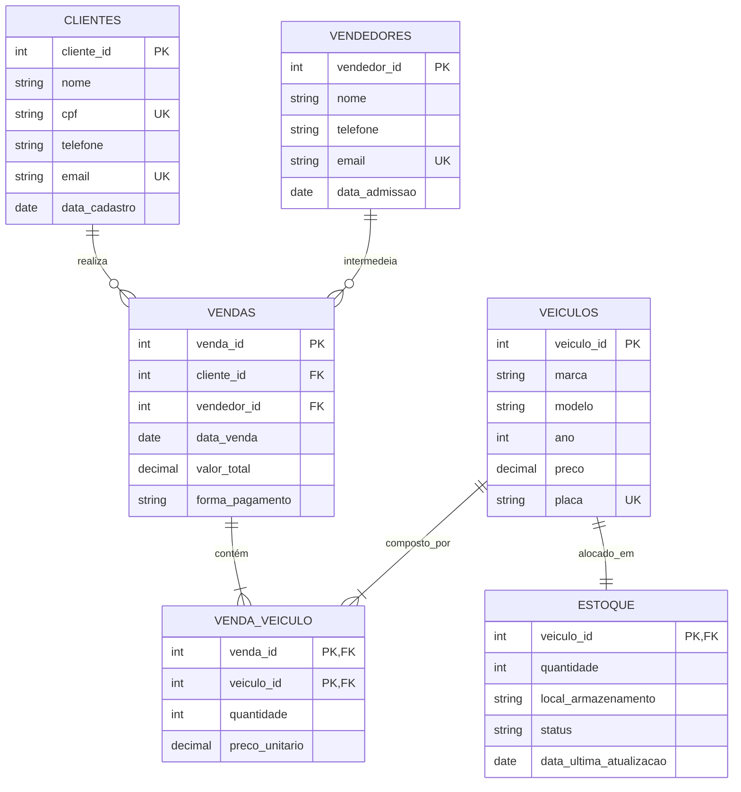

# Sistema de Gestão de Concessionária e Revenda de Veículos (SQL)

<div align="center">


**Modelagem relacional completa, regras de negócio em nível de banco de dados, constraints de integridade e views analíticas.**

</div>

---

## 📋 Visão Geral

Este projeto apresenta a modelagem e implementação do banco de dados relacional **`db_revenda_miguel`**, projetado para gerenciar as operações de uma concessionária de veículos, abrangendo:
- Cadastro de clientes e vendedores.
- Catálogo de veículos com validações de ano, preço e placas únicas.
- Controle de estoque físico (pátios, quantidades e status de disponibilidade).
- Registro detalhado de vendas com vínculo de itens vendidos (relação N:N) e formas de pagamento.
- Camada de abstração analítica através de **SQL Views**.

---

## 🏛️ Modelo de Entidades e Relacionamentos (ERD)



---

## 🛡️ Regras de Negócio e Constraints Implementadas

O esquema foi desenvolvido aplicando regras de validação diretamente na camada de banco de dados:

1. **Unicidade de Registros:**
   - CPFs e e-mails de clientes são únicos (`UNIQUE`).
   - Placas de veículos são únicas (`UNIQUE`) para evitar duplicidade de ativos.
2. **Restrições de Domínio (Check Constraints):**
   - **Ano do Veículo:** `CHECK (ano >= 1900 AND ano <= YEAR(CURDATE()))` — impede o cadastro de anos inválidos ou no futuro.
   - **Preço do Ativo:** `CHECK (preco > 0)` — assegura que nenhum veículo possua valor nulo ou negativo.
   - **Quantidade em Estoque:** `CHECK (quantidade >= 0)` — evita estoque negativo.
   - **Valor Total de Vendas:** `CHECK (valor_total >= 0)`.
3. **Integridade Referencial:**
   - Relacionamento N:N entre Vendas e Veículos resolvido pela tabela associativa `venda_veiculo`, utilizando chave primária composta `PRIMARY KEY (venda_id, veiculo_id)`.

---

## 📊 Views Analíticas

O projeto implementa views para simplificar relatórios e relatórios de auditoria:

### 1. `view_vendas_detalhes`
Consolida os dados de clientes, vendedores e valores transacionados através de `JOINs` otimizados:
```sql
SELECT * FROM view_vendas_detalhes;
```
*Campos retornados:* `venda_id`, `cliente_nome`, `cpf`, `vendedor_nome`, `data_venda`, `valor_total`, `forma_pagamento`.

### 2. `view_estoque_veiculos`
Cruza o cadastro de veículos com seu posicionamento físico nos pátios de estocagem:
```sql
SELECT * FROM view_estoque_veiculos;
```
*Campos retornados:* `veiculo_id`, `marca`, `modelo`, `ano`, `quantidade`, `status`, `local_armazenamento`, `placa`.

---

## 🚀 Como Executar o Script

O script SQL (`Miguel.sql`) é compatível com os principais SGBDs relacionais (MySQL, MariaDB ou PostgreSQL com pequenos ajustes de funções de data).

### No MySQL / MariaDB Workbench ou CLI:
```bash
# Conectar ao banco
mysql -u seu_usuario -p

# Executar o script completo
source caminho/para/Miguel.sql;
```

---

## 📁 Estrutura do Repositório
```text
.
├── README.md        # Documentação técnica do modelo de dados
└── Miguel.sql       # Script DDL, DML (dados de teste), Constraints e Views
```

---

<div align="center">
Desenvolvido por <strong>Miguel Campião Arraes</strong>
</div>
